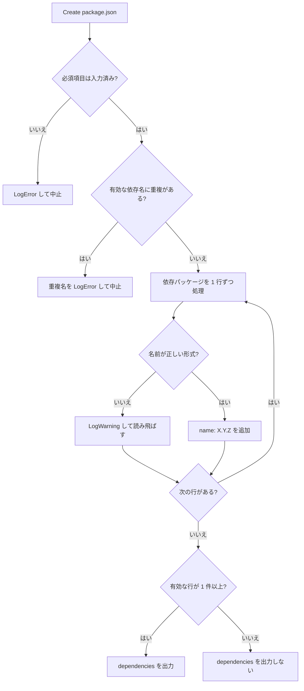

# 設計：依存パッケージの修正

> 対象：`requirements.md`（承認済み版） ／ 作成日：2026-10-20 ／ ステータス：承認済み
> 対象：パッケージ `com.mah.package-json-generator` v1.0.1 ／ 開発環境 Unity 6000.3.26f1（対応 Unity 6000.0 以上）

## 1. 実装アプローチ

依存パッケージから「条件（比較演算子）」の概念をなくし、`DependenciesInfo` は「名前と完全一致のバージョン」だけを持つようにする。演算子を表す `VersionOperator` enum は使う場所が無くなるので削除する。`VersionOperatorConverter` は、Load で既存の制約文字列（`>=1.2.0` など）から完全一致のバージョンを取り出す処理だけを残す。
生成前チェック（`IsCanCreatePackageJson`）に名前の重複チェックを足し、変換（`ConvertToDependencies`）では名前が正しくない行を警告付きで読み飛ばす。パッケージ名の欄は `TextField` を `DelayedTextField` に変え、確定したときだけ検証する。

- 却下：演算子の enum を残して `Equals` だけ選べるようにする案 → 選べない選択肢を残すと UI と コードの両方に意味の無い分岐が残るため
- 却下：重複した名前を後勝ちで上書きする案 → どちらのバージョンが正しいか分からず、利用者の間違いを黙って隠すため

## 2. 変更するコンポーネント

パスは `src/PackageJsonGenerator/Assets/@MAH/PackageJson Generator/Editor/` からの相対パス。

| 対象（クラス/ファイル） | 変更内容 | 新規/修正 |
|---|---|---|
| `Definition/DependenciesInfo.cs` | `Operator`、`OperatorVersion` を削除。コンストラクタと `Reset()` から該当行を削除 | 修正 |
| `Definition/VersionOperater.cs`（＋`.meta`） | `VersionOperator` enum ごとファイルを削除 | 削除 |
| `Utility/VersionOperatorConverter.cs` | `VersionOperatorToOperatorString`、`OperatorStringToVersionOperator`、`SplitVersionConstraint` を削除し、`TryExtractVersion(string constraint, out string version, out bool is_converted)` を追加（下の §2.1）。ファイルとクラス名は変えない（GUID を保つため） | 修正 |
| `PackageJsonCreateWindow.cs`：`DrawDependenciesSettings` | 「条件」の EnumPopup と範囲（以上/以下）の入力欄を削除し、バージョンは常に Major / Minor / Patch の 1 行にする。名前の欄を `DelayedTextField` に変える。手入力で名前が変わったら、ポップアップの選択位置を登録済みパッケージの一覧から探し直す（無ければ先頭） | 修正 |
| `PackageJsonCreateWindow.cs`：定数 | `PACKAGE_INFO_DEPENDENCIES_VERSION_OPERATER_LABEL`、`_FORM_LABEL`、`_TO_LABEL` を削除 | 修正 |
| `PackageJsonCreateWindow.cs`：`IsCanCreatePackageJson` | 依存パッケージの名前の重複チェックを末尾に追加。重複があれば `Debug.LogError("外部パッケージ名が重複しています : <名前>, ...")` を出して `false` を返す | 修正 |
| `PackageJsonCreateWindow.cs`：`ConvertToDependencies` | 名前が空・`com.`・形式に合わない行は `Debug.LogWarning` を出して読み飛ばす。値は `"{x}.{y}.{z}"` だけ。`Add` を `TryAdd` に変える（重複は生成前チェックで止めているが、念のため例外を出さない）。有効な行が 0 件なら `null` を返す | 修正 |
| `PackageJsonCreateWindow.cs`：`ConvertToDependenciesInfo` | `TryExtractVersion` で値を読む。変換した場合と読めなかった場合に `Debug.LogWarning` を出す。ポップアップの選択位置も名前から探して設定する | 修正 |
| `PackageJsonCreateWindow.cs`：新しい private メソッド `FindPackageIndex(string name)` | `UnityPackageHelper.AccPackageNames` から名前の位置を探す。見つからなければ 0 | 修正 |

### 2.1 `TryExtractVersion` の振る舞い

| 入力（前後の空白は無視） | 戻り値 | `version` | `is_converted` |
|---|---|---|---|
| `1.2.3` | `true` | `1.2.3` | `false` |
| `>=1.2.3` / `> 1.2.3` / `<1.2.3` / `<=1.2.3` | `true` | `1.2.3` | `true` |
| `1.0.0 - 2.0.0` / `1.0.0-2.0.0` | `true` | `1.0.0`（下限） | `true` |
| `1.0.0-preview.1`、`file:../foo`、空文字 など | `false` | 空文字 | `false` |

正規表現は今の `VersionOnlyRegex`・`OperatorMatchRegex`・`RangeMatchRegex` をそのまま使う。

### 2.2 Console に出すメッセージ

今の作りに合わせ、日本語でメッセージ文字列をその場に書く（定数化と多言語化は #5・#7 で行う）。

| 場面 | 種類 | 文言 |
|---|---|---|
| 名前の重複（Create） | Error | `外部パッケージ名が重複しています : {名前の一覧}` |
| 名前が不正な行（Create） | Warning | `外部パッケージ名が正しくないため出力しません : {名前}` |
| 演算子付きの値を変換（Load） | Warning | `外部パッケージ {名前} のバージョン "{元の値}" を "{変換後}" に変換しました（UPM は完全一致のバージョンのみ対応）` |
| 読めない値（Load） | Warning | `外部パッケージ {名前} のバージョン "{元の値}" を読み込めないため除外しました` |

## 3. データ構造の変更

- `DependenciesInfo`：`Operator`（`VersionOperator`）と `OperatorVersion`（`Vector3Int`）を削除。メモリ上の入力状態だけで、保存されるデータではないため、移行の処理は要らない
- package.json の出力形式：`dependencies` の値が `"X.Y.Z"` だけになる。これまで演算子付きで出力していた package.json を Load すると、§2.1 の通り完全一致に読み替える（警告付き）

## 4. 影響範囲の分析

- 既存機能への影響
  - 依存パッケージの入力欄の見た目が変わる（「条件」の選択と範囲の 2 行が無くなる）
  - 名前の欄は、Enter かフォーカスアウトで確定するまで値が反映されなくなる（他の検証付きの欄と同じ動き）
  - 依存パッケージ以外の入力・出力は変わらない
- 永続的ドキュメント（Docs/）への影響
  - `Docs/functional-design.md` §2.1：`VersionOperater.cs` の行を削除し、`VersionOperatorConverter.cs` の説明を変える
  - §3.1：外部パッケージ一覧の出力形式を `{ "<name>": "X.Y.Z" }` に変える
  - §4.3：生成前チェックに名前の重複を追加
  - §4.5：条件（演算子）の表を削除し、完全一致だけの仕様と Load 時の読み替え（§2.1 の表）に書き換える。名前の欄が確定時に検証されること、`com.` の行を出力しないことを追記
  - §8：K-1・K-2・K-8・K-11 を修正済みにする。K-24（依存パッケージ名を手入力できない）を追加して修正済みにする。K-19 から `VersionOperater.cs` を外す（ファイルを削除するため）
  - `CHANGELOG.md` `[Unreleased]`：Fixed / Removed に英語で追記
  - `README.md` / `README.ja.md`：依存パッケージの条件について書いた箇所があれば直す（実装時に確認する）
- テストへの影響：自動テストは無い。手動での確認手順を tasklist.md に書く

## 5. 図表

Create 時の依存パッケージの処理の流れ。

