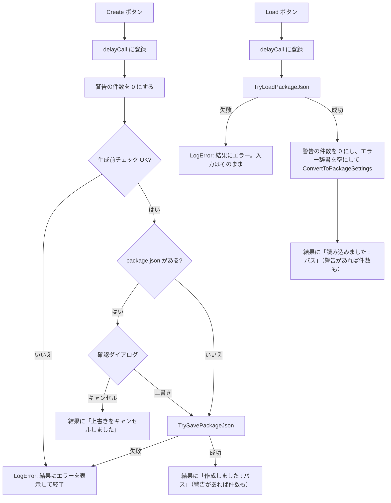

# 設計：入力まわりの UX 改善

> 対象：`requirements.md`（承認済み版） ／ 作成日：2026-10-20 ／ ステータス：承認済み
> 対象：パッケージ `com.mah.package-json-generator` v1.0.1 ／ 開発環境 Unity 6000.3.26f1（対応 Unity 6000.0 以上）

## 1. 実装アプローチ

- **入力エラー（K-12）**：Window に「欄ごとのエラー文」の辞書を持たせる。検証に通らなかったら辞書に入れ、欄の下に `EditorGUILayout.HelpBox` で表示する。正しい値か空になったら辞書から消す。検証は「入力値が今の値と違うときだけ」行う（`DelayedTextField` は確定した 1 フレームだけ新しい値を返し、次のフレームからは今の値を返すため。毎フレーム検証すると、エラーが次のフレームで消えてしまう）
- **操作結果（K-12）**：Window に「最後の操作の結果」（種類と文言）と「警告の件数」を持たせ、ファイル操作の欄に `HelpBox` で表示する。`Debug.LogWarning` / `Debug.LogError` の呼び出しを、Console への出力と結果の記録を同時に行う private メソッドに置き換える
- **ファイル操作（K-13、K-14、K-26、K-27）**：`PackageJsonFileUtility` の保存・読込を、例外を出さずに成否とエラー文を返す `TrySavePackageJson` / `TryLoadPackageJson` に変える。上書きの確認ダイアログは UI なので Window 側で出す。Create / Load の処理は `EditorApplication.delayCall` で `OnGUI` の外で実行する（`OnGUI` のレイアウトの途中でモーダルダイアログを出すと、レイアウトのエラーが出ることがあるため）
- **ドメインリロード（K-15）**：入力状態のクラスに `[Serializable]`、フィールドに `[SerializeField]` を付け、Window のフィールドも `[SerializeField]` にする。`OnEnable` は「初期化済みフラグ」が立っていないときだけ初期化する

- 却下：入力エラーを `Debug.LogWarning` で Console に出すだけにする案 → 入力のたびに Console を見る必要があり、K-12 の「その場で知らせる」にならないため
- 却下：`ScriptableSingleton` などでファイルに保存する案 → ドメインリロードで残すだけなら EditorWindow のシリアライズで足りる。閉じても残す仕組みは #10 で検討する

## 2. 変更するコンポーネント

パスは `src/PackageJsonGenerator/Assets/@MAH/PackageJson Generator/Editor/` からの相対パス。

| 対象（クラス/ファイル） | 変更内容 | 新規/修正 |
|---|---|---|
| `Utility/PackageJsonFileUtility.cs` | `SavePackageJson` / `LoadPackageJson` を `TrySavePackageJson(string folder, PackageJsonInfo info, out string error_message)` / `TryLoadPackageJson(string folder, out PackageJsonInfo info, out string error_message)` に置き換える（§2.3）。`GetPackageJsonPath(string folder)` を追加。Console への出力は Window 側に任せる | 修正 |
| `Definition/PackageRequiredSettings.cs`、`PackageOptionalSettings.cs` | クラスに `[Serializable]`、各フィールドに `[SerializeField]` を付ける | 修正 |
| `Definition/DependenciesInfo.cs`、`AuthorInfo.cs`、`SampleInfo.cs` | クラスに `[Serializable]` を付ける（フィールドは `public` なのでそのままシリアライズされる） | 修正 |
| `PackageJsonCreateWindow.cs`：フィールドと `OnEnable` | 入力状態のフィールドに `[SerializeField]` を付け、`[SerializeField] bool _isInitialized` を追加。`OnEnable` は未初期化のときだけ初期化し、`UnityPackageHelper.LoadPackageInfo()` は毎回呼ぶ。`_fieldErrors`（`Dictionary<object, string>`）、`_resultMessage`、`_resultMessageType`、`_warningCount` を追加（シリアライズしない） | 修正 |
| `PackageJsonCreateWindow.cs`：新しい private メソッド（`//====メッセージ====` の区切りにまとめる） | `SetFieldError(object key, string message)`、`ClearFieldError(object key)`、`DrawFieldError(object key)`、`LogWarning(string message)`、`LogError(string message)`、`SetResultMessage(MessageType type, string message)`、`DrawResultMessage()` | 修正 |
| `PackageJsonCreateWindow.cs`：各欄の描画 | §2.1 の欄で、値が変わったときだけ検証し、エラーの登録・解除と `DrawFieldError` を行う | 修正 |
| `PackageJsonCreateWindow.cs`：`DrawFileOptionButton`、新しい `CreatePackageJson()` / `LoadPackageJson()` | ボタンでは `EditorApplication.delayCall` に登録するだけにし、処理は新しいメソッドで行う（§2.2） | 修正 |
| `PackageJsonCreateWindow.cs`：`DrawPackageFileOperations` | ボタンの上に `DrawResultMessage()` を追加 | 修正 |
| `PackageJsonCreateWindow.cs`：`IsCanCreatePackageJson`、`ConvertToPackageSettings` などの `Debug.LogError` / `Debug.LogWarning` | `LogError` / `LogWarning` に置き換える | 修正 |

### 2.1 入力エラーを表示する欄と文言

エラーの辞書のキーは、固定の欄は定数の文字列、リストの行はその行のオブジェクト（`DependenciesInfo` / `SampleInfo`）にする。

| 欄 | 文言 |
|---|---|
| パッケージ名・外部パッケージ名 | `「{値}」はパッケージ名の形式ではありません（例：com.company.my-tool。小文字の英数字とハイフンをドットで区切ります）` |
| 著者の E-mail | `「{値}」は E-mail の形式ではありません（例：name@example.com）` |
| 著者の URL・変更ログ URL・ドキュメント URL・ライセンス URL | `「{値}」は URL の形式ではありません（http:// か https:// で始めてください）` |
| サンプルのパス | `「{値}」からサンプルのパスを作れません。Samples か Samples~ フォルダの下のフォルダを指定してください（例：Samples~/Basic）` |

Load に成功したら、辞書を空にする。

### 2.2 Create / Load の流れ

処理のあとに `Repaint()` を呼んで、結果をすぐ表示する。

### 2.3 `PackageJsonFileUtility` のエラー

| 場面 | `error_message` |
|---|---|
| フォルダーパスが空（保存・読込） | `フォルダーパスが指定されていません` |
| フォルダが無い（保存） | `フォルダが存在しません : {フォルダ}` |
| ファイルが無い（読込） | `指定したフォルダに package.json が存在しません : {パス}` |
| JSON として読めない・中身が空（読込） | `package.json を読み込めませんでした : {例外のメッセージ}` |
| 書き込み・読み込みの失敗（`IOException`、`UnauthorizedAccessException`） | `package.json を保存できませんでした : {例外のメッセージ}` / `package.json を読み込めませんでした : {例外のメッセージ}` |

捕まえる例外は `IOException`、`UnauthorizedAccessException`、`JsonException`（Newtonsoft）に限る。それ以外はプログラムの誤りなので捕まえない。

### 2.4 操作結果の表示

| 場面 | 種類 | 文言 |
|---|---|---|
| Create 成功 | Info（警告があれば Warning） | `package.json を作成しました : {パス}`（警告があれば ` / 警告 {n} 件（詳しくは Console を参照）` を後ろに付ける） |
| Load 成功 | Info（警告があれば Warning） | `package.json を読み込みました : {パス}`（同上） |
| 上書きのキャンセル | Info | `上書きをキャンセルしました` |
| 失敗 | Error | 生成前チェックまたは §2.3 の文言 |

確認ダイアログ：タイトル `package.json の上書き`、本文 `{パス} は既に存在します。上書きしますか？`、ボタン `上書き` / `キャンセル`。

## 3. データ構造の変更

- `PackageRequiredSettings`、`PackageOptionalSettings`、`DependenciesInfo`、`AuthorInfo`、`SampleInfo` が Unity のシリアライズ対象になる。Unity のシリアライズは `null` を持てないため、ドメインリロードの後は `null` だった文字列が空文字になる。どこも `string.IsNullOrEmpty` / `IsNullOrWhiteSpace` で判定しているので、出力は変わらない
- `AuthorInfo`、`SampleInfo` に `[Serializable]` を付けても、Newtonsoft の JSON の出力は変わらない
- package.json の形式は変わらない。移行の作業は要らない

## 4. 影響範囲の分析

- 既存機能への影響
  - 入力エラーと操作結果がウィンドウに表示される（表示が増える）
  - Load に失敗しても入力が消えない（`PackageRequiredSettings.Reset()` / `PackageOptionalSettings.Reset()` は呼ばれなくなるが、#10 で使う見込みなので残す）
  - Create / Load の処理が、ボタンを押した次のエディタ更新で実行される（体感の差は無い）
  - 既存の package.json がある場所への Create は、確認ダイアログを通るようになる
- 永続的ドキュメント（Docs/）への影響
  - `Docs/functional-design.md` §2.2：状態の表にシリアライズの有無と新しいフィールドを追加し、`OnEnable` の説明を直す
  - §2.3：データフローの図を、確認ダイアログ・Try 系のメソッド・失敗時に入力を残す流れに直す
  - §4 の冒頭：「何も通知されずに破棄」を「欄の下にエラーを表示して直前の値を残す」に直す
  - §5：Create・Load の振る舞いを直す（上書き確認、フォルダが無い場合、壊れた JSON、失敗時に入力を残す）
  - §6.2：レイアウトに入力エラーと操作結果の表示を追加
  - §7：永続化（ドメインリロードでは残る）とエラー通知（ウィンドウにも表示）を直す
  - §8：K-12〜K-15 を修正済みにし、K-26・K-27 を追加して修正済みにする
  - `CHANGELOG.md` `[Unreleased]`：Added / Fixed に英語で追記
  - `README.md` / `README.ja.md`：既知の制限事項の 3 項目（メッセージが出ない、確認せずに上書き、入力が保存されない）を削除または書き換える。「ウィンドウを閉じると入力が消える」は残る制限として書き換える
- テストへの影響：自動テストは無い。手動での確認手順を tasklist.md に書く
