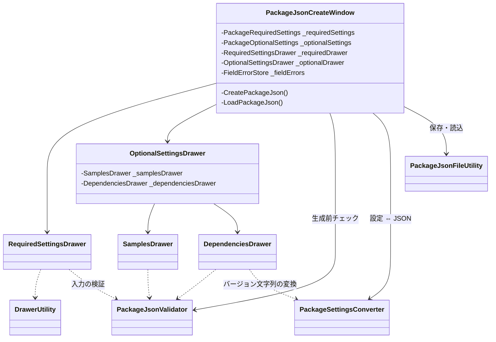

# 設計：ウィンドウの責務分割

> 対象：`requirements.md`（承認済み版） ／ 作成日：2026-10-21 ／ ステータス：承認済み
> 対象：開発環境 Unity 6000.3.26f1

## 1. 実装アプローチ

`PackageJsonCreateWindow` の処理を、次の 3 種類に分ける。
1. **検証**（`PackageJsonValidator`）と**変換**（`PackageSettingsConverter`）：Unity の画面に依存しない static クラス。`Debug` も呼ばず、警告は `List<string>` に入れて返す。これで EditMode のテストから直接呼べる
2. **描画**（`Editor/Drawer/` の新しいフォルダ）：セクションごとの Drawer クラス。Foldout の開閉などの画面の状態は Drawer が `[SerializeField]` で持ち、Window が Drawer を `[SerializeField]` のフィールドとして持つ（ドメインリロードで残すため）
3. **Window**：Drawer を並べ、ファイル操作の欄と Create / Load の処理、操作結果の表示を行う

入力状態のクラス（`PackageRequiredSettings` など）は今のまま使い、各 Drawer の `Draw` に引数で渡す。入力エラーの辞書は `FieldErrorStore` クラスに移し、Window が 1 つ持って Drawer に渡す。

- 却下：Window を partial クラスにしてファイルだけ分ける案 → 1 つのクラスが全部の状態を持つことは変わらず、検証・変換をテストから単独で呼べないため
- 却下：UI Toolkit に作り直す案 → 振る舞いを変えないという今回の条件から外れるため

## 2. 変更するコンポーネント

パスは `src/PackageJsonGenerator/Assets/@MAH/PackageJson Generator/Editor/` からの相対パス（テストを除く）。

| 対象（クラス/ファイル） | 変更内容 | 新規/修正 |
|---|---|---|
| `Utility/PackageJsonValidator.cs` | Window から移す：パッケージ名・E-mail・URL の正規表現と `IsValidPackageName` / `IsValidEmail` / `IsValidURL`、`IsValidSampleFolderpath`、生成前チェック（`CanCreatePackageJson(required, optional, out string error_message)`。チェックの順番と文言は今と同じ） | 新規 |
| `Utility/PackageSettingsConverter.cs` | Window から移す：`ConvertToPackageJsonInfo`、`ConvertToPackageSettings`（既存の設定オブジェクトに書き込む）、`ConvertToVersionString`、`TryConvertToVersionVector`、`ConvertToUnityVersion`、`ConvertToDependencies`、`ConvertToDependenciesInfo`、`FindPackageIndex`。警告は `List<string> warnings` に追加する | 新規 |
| `Drawer/FieldErrorStore.cs` | 入力エラーの辞書（`Set` / `Clear` / `ClearAll` / `Draw`） | 新規 |
| `Drawer/DrawerUtility.cs` | Drawer が共通で使うもの：共通のラベル（Major / Minor / Patch、Add / Remove、Browse / Reset / Open URL など）、レイアウトの幅、入力エラーの文言、`DrawValidatedTextField`、`DrawSectionTitle`（中央寄せの太字見出し）、`DrawVersionFields`（K-22。負の値は 0 にする） | 新規 |
| `Drawer/RequiredSettingsDrawer.cs` | 必須項目（パッケージ情報・対応 Unity バージョン・ライセンス・著者）の描画。`_licenseType` / `_licenseName` を持つ。`ResetLicense(settings)`（初期化時）と `SyncLicense(settings)`（Load 後）を持つ | 新規 |
| `Drawer/OptionalSettingsDrawer.cs` | 任意項目（Unity 情報・ドキュメント・キーワード）の描画。`_isShowKeyword` と、下の 2 つの Drawer を持つ | 新規 |
| `Drawer/SamplesDrawer.cs` | サンプルの描画。`_isShowSamples` を持つ | 新規 |
| `Drawer/DependenciesDrawer.cs` | 外部パッケージの描画と、ポップアップで選んだときの `SetDependenciesInfo`。`_isShowDependencies` を持つ | 新規 |
| `PackageJsonCreateWindow.cs` | 上のクラスへ処理を移し、Window の定数・フィールド・`OnEnable`・`ShowWindow`・`OnGUI`・ファイル操作の欄・`CreatePackageJson` / `LoadPackageJson`・メッセージ（`LogWarning` / `LogError` / 操作結果）だけを残す。クラス名・GUID・メニューのパスは変えない | 修正 |
| `AssemblyInfo.cs` | `[assembly: InternalsVisibleTo("MAH.PackageJson_Generator.Editor.Tests")]`（テストから `internal` のクラスを呼ぶため。利用者の環境では効果が無い） | 新規 |
| `Assets/@MAH/Tests/Editor/MAH.PackageJson_Generator.Editor.Tests.asmdef` | テスト用の asmdef（Editor 限定、`UNITY_INCLUDE_TESTS` のときだけコンパイル、`MAH.PackageJson_Generator.Editor` と Test Runner と `nunit.framework.dll` を参照） | 新規 |
| `Assets/@MAH/Tests/Editor/PackageJsonValidatorTests.cs`、`PackageSettingsConverterTests.cs` | EditMode テスト（§2.2） | 新規 |

新しいフォルダ（`Drawer/`、`Assets/@MAH/Tests/`、`Assets/@MAH/Tests/Editor/`）とファイルには、新しく生成した GUID の `.meta` を付ける。

### 2.1 呼び出しの関係

### 2.2 自動テストの内容（EditMode）

| テストクラス | 主な内容 |
|---|---|
| `PackageJsonValidatorTests` | パッケージ名・E-mail・URL の正しい値と不正な値。サンプルのパス（#2 の design.md §2.2 の表の各行）。生成前チェック（各必須項目が空、名前の形式違い、外部パッケージ名の重複、すべて正しい場合） |
| `PackageSettingsConverterTests` | `TryConvertToVersionVector`（#3 の design.md §2.4 の表の各行）。`unity` の解析（#3 の §2.3 の各行と警告の有無）。依存パッケージの変換（完全一致・演算子付き・範囲・読めない値、`com.` の行の除外）。全項目を入れた入力状態 → `PackageJsonInfo` → 入力状態の往復で値が変わらないこと |

テストは NUnit の `[Test]` / `[TestCase]` で書く。

### 2.3 移すときに変えないもの

- 文言（ラベル・入力エラー・Console のメッセージ・ダイアログ）とその出る順番
- チェックの順番（生成前チェックは、今と同じ順で最初のエラーだけを返す）
- `PacckageName` など綴りの誤りがある識別子（#6 で直す）
- 外部パッケージのポップアップでプレビュー版を選んだときの警告は、今は Window の `LogWarning`（Console 出力と件数のカウント）を通っている。件数は次の Create / Load で 0 に戻るため、Drawer からは `Debug.LogWarning` を直接呼ぶ形にしても、利用者から見た動きは変わらない

## 3. データ構造の変更

- 入力状態のクラス・`PackageJsonInfo`・package.json の形式は変わらない
- Window のシリアライズされるフィールドが変わる（Foldout の開閉とライセンスの選択が Drawer の中に移る）。開発中に古いコードの状態からドメインリロードした 1 回だけ、Foldout が閉じたりライセンスの表示名が空になったりすることがある。利用者には、更新後にウィンドウを開き直せば影響は無い

## 4. 影響範囲の分析

- 既存機能への影響
  - 利用者から見た動きは変わらない（K-22 の負の値の扱いだけが変わる）
  - パッケージに `AssemblyInfo.cs` と `Drawer/` フォルダが増える
- 永続的ドキュメント（Docs/）への影響
  - `Docs/functional-design.md` §1.1：構成図を新しいクラスに直す
  - §2.1：コンポーネント構成の表に新しいファイルを追加し、Window の説明を直す
  - §2.2：状態の表の Foldout とライセンスを Drawer に移す
  - §2.3：データフローの図の参加者を直す
  - §4.3・§4.4 などで Window のメソッド名を書いている箇所を、移したクラスのメソッド名に直す
  - §8：K-20・K-22 を修正済みにする
  - `CONTRIBUTING.md` §1（リポジトリ構成）にテストのフォルダを、§5（動作確認）に Test Runner での確認を追加する
  - `CLAUDE.md` の「新しいクラスを作る前に `Definition/` か `Utility/` の似たクラスを読む」に `Drawer/` を加える
  - `CHANGELOG.md` `[Unreleased]`：Fixed に K-22 を英語で追記（分割は利用者に関係しないので書かない）
  - `README.md` / `README.ja.md`：変更なし
- テストへの影響：EditMode テストを新しく追加する（§2.2）
