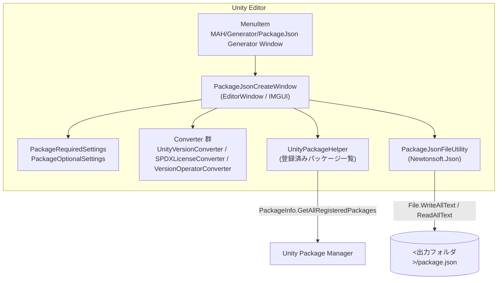
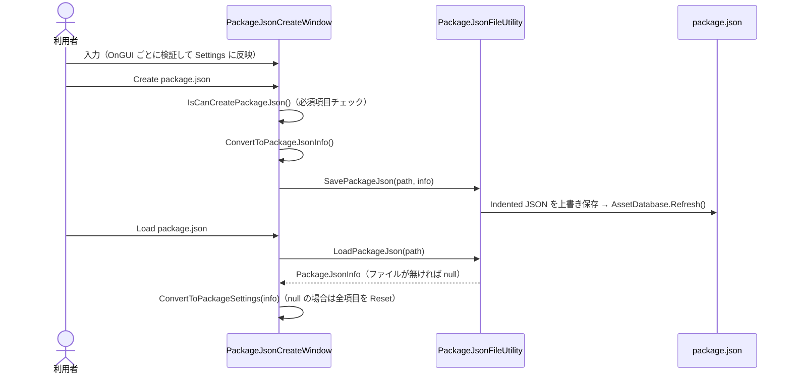

# 機能設計書：PackageJson Generator

> 最終更新日：2026-10-20 ／ 対象バージョン：パッケージ `com.mah.package-json-generator` v1.0.1／開発環境 Unity 6000.3.26f1（対応 Unity 6000.0 以上）
> 関連文書：`README.md`（利用者向け）／`CONTRIBUTING.md`（開発手順）／`CLAUDE.md`（AI向け作業ルール）
> **位置づけ**：本書は **現状の実装の振る舞い** を書き起こしたもので、「あるべき仕様」ではない。実装とずれている点や不具合の候補は §8「既知の問題」にまとめ、修正は別の作業で行う。PRD・アーキテクチャ文書・用語集はまだ無いので、クラス名はコード上の名前をそのまま使う

## 1. システム概要

### 1.1 構成図

Unity Editor の中だけで動く拡張機能（`#if UNITY_EDITOR`、asmdef `MAH.PackageJson_Generator.Editor` は Editor プラットフォーム限定）。サーバー通信やランタイムのコードは無い。



### 1.2 画面構成

画面は EditorWindow が 1 つだけ。シーンは使わない（§6 を参照）。

## 2. 機能アーキテクチャ

### 2.1 コンポーネント構成

```text
PackageJson Generator/
├── package.json                         # このツール自身のパッケージ定義
└── Editor/
    ├── MAH.PackageJson_Generator.Editor.asmdef
    ├── PackageJsonCreateWindow.cs       # UI描画・入力検証・設定⇔JSONモデル変換（約1,080行に責務が集中）
    ├── Definition/
    │   ├── PackageJsonInfo.cs           # JSONシリアライズ用モデル（[JsonProperty]）
    │   ├── AuthorInfo.cs / SampleInfo.cs# JSONモデルの子要素（UIの入力値としても使う）
    │   ├── PackageRequiredSettings.cs   # 必須項目の入力状態
    │   ├── PackageOptionalSettings.cs   # 任意項目の入力状態
    │   ├── DependenciesInfo.cs          # 依存パッケージ1件の入力状態
    │   ├── LicenseType.cs               # ライセンス選択肢 enum
    │   ├── VersionOperater.cs           # 依存バージョン条件 enum（ファイル名の綴りは原文のまま）
    │   └── UnityVersion/                # MajorVersion と MinorVersion_<Major> enum 群
    └── Utility/
        ├── PackageJsonFileUtility.cs    # 保存・読込、空値除外 Resolver
        ├── SPDXLicenseUtility.cs        # クラス名は SPDXLicenseConverter
        ├── UnityPackageHelper.cs        # プロジェクトに登録済みのパッケージ名・バージョンのキャッシュ
        ├── UnityVersionConverter.cs     # Major⇔Minor enum型、Major⇔文字列
        └── VersionOperatorConverter.cs  # 条件enum⇔演算子文字列、バージョン制約の分解
```

> ※ 開発用プロジェクトの `Assets/@MAH/Editor/Utility/LanguageUtility.cs` はこのパッケージに含まれず、どこからも参照されていない

### 2.2 状態

フェーズ（状態機械）は無い。入力状態は `PackageJsonCreateWindow` のフィールドに保持される。

| フィールド | 型 | 説明 |
|---|---|---|
| `_requiredSettings` | `PackageRequiredSettings` | 必須項目 |
| `_optionalSettings` | `PackageOptionalSettings` | 任意項目 |
| `_licenseType` / `_licenseName` | `LicenseType` / `string` | ライセンスの選択値と表示名 |
| `_pacckageJsonPath` | `string` | 入出力フォルダ。初期値は `Assets` |
| `_isShowKeyword` / `_isShowSamples` / `_isShowDependencies` | `bool` | 各リストの Foldout 開閉 |

`OnEnable` で上記を毎回初期化し、`UnityPackageHelper.LoadPackageInfo()` を呼ぶ（§8 の K-15 を参照）。

### 2.3 データフロー



## 3. データモデル定義

### 3.1 入力項目と package.json キーの対応

UI ラベルはコード上の日本語ラベルをそのまま載せる。

| 区分 | UIラベル | 保持先 | JSONキー | 出力形式・変換 |
|---|---|---|---|---|
| 必須 | パッケージ名 | `PackageRequiredSettings.Name` | `name` | 小文字化してから検証する。初期値は `com.mypackage` |
| 必須 | バージョン (Major/Minor/Patch) | `Version` (`Vector3Int`) | `version` | `"{x}.{y}.{z}"` |
| 必須 | UPM表示名 | `DisplayName` | `displayName` | そのまま |
| 必須 | 概要 | `Description` | `description` | そのまま（TextArea） |
| 必須 | 対応 Unity バージョン (Major/Minor) | `MajorVer` / `MinorVer` | `unity` | `"{Major文字列}.{Minor}"`（例 `6000.0`）。Major を変えると Minor は `1` に戻る |
| 必須 | ライセンス | `License` | `license` | `LicenseType` を SPDX ID に変換（§3.3） |
| 必須 | 著者名 / E-mail / URL | `AuthorInfo` | `author.name` / `.email` / `.url` | 必須なのは名前だけ |
| 任意 | リリースバージョン | `PackageOptionalSettings.UnityRelease` | `unityRelease` | そのまま（形式の検証は無い） |
| 任意 | UMP除外フラグ | `HideInEditor` | `hideInEditor` | bool。false でも必ず出力される |
| 任意 | 変更ログURL | `ChangelogURL` | `changelogUrl` | URL検証あり |
| 任意 | ドキュメントURL | `DocumentationURL` | `documentationUrl` | URL検証あり |
| 任意 | ライセンスURL | `LicensesURL` | `licensesUrl` | URL検証あり |
| 任意 | キーワード一覧 | `Keywords` | `keywords` | 文字列配列 |
| 任意 | サンプル一覧（表示名/概要/パス） | `SamplesInfo` | `samples[].displayName/description/path` | パスは `Samples~` 起点に正規化（§4.4） |
| 任意 | 外部パッケージ一覧 | `Dependencies` | `dependencies` | `{ "<name>": "<制約文字列>" }`（§4.5） |

### 3.2 出力時の値の除外ルール

`IgnoreEmptyAndNullResolver`（`PackageJsonFileUtility.cs`）がすべてのプロパティに対して次の値を出力から外す。

- `null`
- 空文字列または空白だけの文字列
- 要素数 0 の `ICollection`（List / Dictionary）

`bool` は除外の対象外なので、`hideInEditor` は常に出力される。

### 3.3 ライセンス対応表（`SPDXLicenseConverter`）

| `LicenseType` | 出力 (`license`) | 表示名 |
|---|---|---|
| `Unlicense`（初期値） | `Unlicense` | The Unlicense |
| `Proprietary` | `Proprietary` | Proprietary |
| `MIT` | `MIT` | MIT License |
| `Apache_2_0` | `Apache-2.0` | Apache License 2.0 |
| `GPL_3_0` | `GPL-3.0` | GNU General Public License v3.0 |
| `LGPL_3_0` | `LGPL-3.0` | GNU Lesser General Public License v3.0 |
| `MPL_2_0` | `MPL-2.0` | Mozilla Public License 2.0 |
| `BSD_3_Clause` | `BSD-3-Clause` | BSD 3-Clause License |
| `CC0_1_0` | `CC0-1.0` | Creative Commons Zero v1.0 |
| `EPL_2_0` | `EPL-2.0` | Eclipse Public License 2.0 |
| `Other` | 空文字（任意入力欄が表示される） | — |

Load したときに表に無い SPDX ID が書かれていた場合は `Other` として扱う。

### 3.4 対応 Unity バージョンの選択肢

| `MajorVersion` | 文字列 | Minor 選択肢 |
|---|---|---|
| `Unity_6` | `6000` | 0, 1, 2 |
| `Unity_2023` / `2022` / `2021` / `2020` | 年 | 1, 2, 3 |
| `Unity_2019` / `2018` / `2017` | 年 | 1, 2, 3, 4 |
| `Unity_5` | `5` | 1〜6 |

### 3.5 出力例

全項目を入力した場合（`samples` のパス区切りは Windows の場合。§8 K-9 を参照）。

```json
{
  "name": "com.example.my-tool",
  "version": "1.2.0",
  "description": "Example package",
  "displayName": "My Tool",
  "unity": "6000.0",
  "unityRelease": "0f1",
  "license": "MIT",
  "licensesUrl": "https://example.com/license",
  "changelogUrl": "https://example.com/changelog",
  "documentationUrl": "https://example.com/docs",
  "hideInEditor": false,
  "author": { "name": "Example", "email": "dev@example.com", "url": "https://example.com" },
  "keywords": [ "tool" ],
  "dependencies": { "com.unity.nuget.newtonsoft-json": "3.2.1" },
  "samples": [ { "displayName": "Basic", "description": "Basic sample", "path": "Samples~\\Basic" } ]
}
```

## 4. 入力検証仕様

検証に通らなかった入力は **何も通知されずに破棄され、直前の値が残る**。`DelayedTextField` を使っている欄は、Enter かフォーカスアウトで確定したときに検証される。

### 4.1 パッケージ名（`IsValidPackageName`）

- 正規表現：`^[a-z0-9\-]+(\.[a-z0-9\-]+)+$`（ドットで区切った 2 要素以上）
- 入力値は先に `ToLowerInvariant()` で小文字化される
- 空にした場合は `com.mypackage` に戻る

### 4.2 E-mail / URL

| 項目 | 正規表現 | 空にした場合 |
|---|---|---|
| E-mail | `^[^@\s]+@[^@\s\.]+\.[^@\s\.]+(\.[^@\s\.]+)*$` | 空文字（出力されない） |
| URL（著者・各種ドキュメント） | `^https?:\/\/[\w\-]+(\.[\w\-]+)+([\/\w\-.~:?#[\]@!$&'()*+,;=]*)?$` | 空文字（出力されない） |

各 URL 欄の `Open URL` ボタンは、設定済みの値を `Application.OpenURL` で開く。

### 4.3 生成前チェック（`IsCanCreatePackageJson`）

次のどれかが空白なら `Debug.LogError` を出して生成を中止する：パッケージ名、概要、UPM表示名、ライセンス、著者名。バージョンと Unity バージョンはチェックしない。

### 4.4 サンプルのパス（`IsValidSampleFolderpath`）

1. `Browse` でフォルダを選ぶか、テキストを直接入力する
2. パスの中で最後に現れる `Samples`（大文字小文字は区別しない）の位置を探す。見つからなければ `Samples~` を探す。どちらも無ければ値を変えない
3. 見つけた語より後ろの部分を取り出し、先頭の `Path.DirectorySeparatorChar` を取り除いてから `Path.Combine("Samples~", <残り>)` でつなぐ
4. 残りが空なら値を変えない

初期値：空のリストに最初に追加した要素は `Samples~`、2 件目以降は `null`。`Reset` ボタンを押すと `Samples` になる。

### 4.5 依存パッケージ（`dependencies`）

- パッケージ名は小文字化してから §4.1 と同じ規則で検証する。空にすると `com.` に戻る
- 右側の Popup で、プロジェクトに登録済みのパッケージ（`UnityPackageHelper`）を選べる。選ぶと名前とバージョンが入力される。先頭の `– Select Package –` を選ぶと、その行がリセットされる
- 条件（`VersionOperator`）と出力形式：

| enum | 出力例 | Load 時に認識される形 |
|---|---|---|
| `Equals` | `1.0.0` | `1.0.0` |
| `GreaterThan` | `> 1.0.0`（記号の後に空白が入る） | `>1.0.0` / `> 1.0.0` |
| `GreaterOrEqual` | `>=1.0.0` | 同左（空白可） |
| `LessThan` | `<1.0.0` | 同左 |
| `LessOrEqual` | `<=1.0.0` | 同左 |
| `Range` | `1.0.0 - 2.0.0` | `1.0.0-2.0.0`（空白可） |

上の 3 形式（`SplitVersionConstraint`）のどれにも当てはまらない値は、Load のときに読み飛ばされる。

## 5. ファイル入出力仕様

| 操作 | 振る舞い |
|---|---|
| 入出力フォルダ | テキスト入力、または `Browse`（`Application.dataPath` 配下を選んだ場合は `Assets/...` の相対パスに変換）。`Reset` で `Assets` に戻る |
| Create package.json | `<フォルダ>/package.json` を確認なしで **上書き** し、`AssetDatabase.Refresh()` を呼ぶ。フォルダが空白なら `Debug.Log` を出して中止する |
| Load package.json | `<フォルダ>/package.json` を読み込み、入力欄に反映する。ファイルが無い場合は `Debug.Log` を出し、**入力中の内容をすべてリセット** する |
| 文字コード | `File.WriteAllText` の既定（UTF-8、BOM なし） |

## 6. 画面設計

### 6.1 画面一覧

| 画面ID | 画面名 | 実装 | 起動方法 |
|---|---|---|---|
| WIN-001 | PackageJson Generator | `PackageJsonCreateWindow`（IMGUI EditorWindow） | メニュー `MAH/Generator/PackageJson Generator Window` |

### 6.2 WIN-001 レイアウト

```text
┌ ScrollView ───────────────────────────────┐
│ [必須設定項目]                              │
│   パッケージ情報設定（名前/バージョン/UPM表示名/概要）│
│   対応 Unity バージョン設定（Major/Minor）      │
│   ライセンス情報設定                          │
│   著者情報設定（著者名/E-mail/URL + Open URL）  │
│ [任意設定項目]                              │
│   Unity 情報設定（リリースバージョン/UMP除外フラグ） │
│   ドキュメント情報設定（3種URL + Open URL）      │
│   キーワード / サンプル / 外部パッケージ（Foldoutリスト）│
└──────────────────────────────────────────┘
[package.json ファイル操作]（スクロールしない固定領域）
  フォルダーパス [_____] [Browse] [Reset]
  [Create package.json] [Load package.json]
```

リストの操作は次の通り。キーワードは各行に `Remove` がある。サンプルと外部パッケージは、リスト末尾の `Remove`（最後の要素を消す）と `Add` で操作する。

## 7. 非機能設計

| 項目 | 内容 |
|---|---|
| 依存 | `com.unity.nuget.newtonsoft-json` 3.2.1（このツール自身の package.json で宣言） |
| 対応 Unity | 6000.0 以上（package.json の `unity`） |
| 永続化 | 入力内容は保存されない（ウィンドウを開き直したり、ドメインリロードが起きると消える） |
| エラー通知 | Console への `Debug.Log` / `Debug.LogError` だけ。メッセージは日本語 |
| ローカライズ | UI ラベルは日本語の固定文字列（`const`） |

## 8. 既知の問題（次フェーズへの入力）

コードを読んで見つけた不具合の候補。「要検証」は Editor で動かしての確認がまだのもの。

| ID | 区分 | 内容 | 該当箇所 |
|---|---|---|---|
| K-1 | 仕様不整合 | UPM の `dependencies` は厳密なバージョン指定しか受け付けないが、比較演算子と範囲（`>=`、`1.0.0 - 2.0.0` など）を出力できてしまう | `VersionOperatorConverter` |
| K-2 | 不具合 | `GreaterThan` だけ出力が `"> "`（記号の後に空白）になり、他の演算子と形式が揃っていない | `VersionOperatorToOperatorString` |
| K-3 | 不具合 | ライセンスに `Other` を選ぶと、入力欄の値が保存されず `License` が空のままになる。そのため必ず生成エラーになる | `DrawLicenseInfoSettings` |
| K-4 | 不具合 | Load で `unity` が `"6000"` のように Minor を持たない場合、`Length < 1` の判定ではすり抜けて `IndexOutOfRangeException` が起きる | `ConvertToMinorVersion` |
| K-5 | 不具合 | Load で `unity` が無い場合や未対応の Major の場合に `NotImplementedException` が発生し、読み込みが止まる | `ConvertToMajorVersion` / `StringToMajorVersion` |
| K-6 | 不具合 | Load で `version` が無い場合は NRE が起きる。4 要素以上（例 `1.0.0.1`）の場合は `Vector3Int` のインデックス範囲外になる | `ConvertToVersionVector` |
| K-7 | 不具合 | Minor が enum に無い値（例 `6000.3`）を Load すると、EnumPopup に正しく表示されない（要検証） | `DrawUnityVersionSettings` |
| K-8 | 不具合 | 依存パッケージに同じ名前が 2 件あると `Dictionary.Add` が例外を投げ、生成が失敗する | `ConvertToDependencies` |
| K-9 | 不具合 | サンプルのパスが `Path.Combine` で作られるため、Windows では `\` 区切りで出力される。また、OpenFolderPanel が返す `/` 区切りのパスは TrimStart で取り除かれず、結果がルートパス扱いになる恐れがある。`Samples~` を選んだ場合も先に `Samples` に一致するため、`~` が残る恐れがある（要検証） | `IsValidSampleFolderpath` |
| K-10 | 不具合 | サンプルの初期パスが一定しない（1 件目は `Samples~`、2 件目以降は `null`、Reset 時は `Samples`） | `DrawSamplesInfoSettings` |
| K-11 | 不具合 | 依存パッケージの初期値 `com.` は検証に通らない値のまま出力される（`"com.": "0.0.0"`） | `DependenciesInfo` |
| K-12 | UX | 入力が検証に通らなかったときに何も通知されず、直前の値に戻るだけ | `PackageJsonCreateWindow` 全般 |
| K-13 | UX | Load でファイルが見つからないと、入力中の内容がすべてリセットされる | `ConvertToPackageSettings` |
| K-14 | UX | Create のときに既存ファイルを確認なしで上書きする | `SavePackageJson` |
| K-15 | UX | `OnEnable` で毎回初期化するので、スクリプトの再コンパイルなどのドメインリロードで入力内容が消える | `OnEnable` |
| K-16 | 不具合 | `PackageOptionalSettings.Reset()` が `HideInEditor` をリセットしない | `PackageOptionalSettings` |
| K-17 | 不具合 | 対応 Unity の選択肢が古い（Unity 6 は 6000.0〜6000.2 まで。Unity 5 に 5.0 が無い） | `Definition/UnityVersion/` |
| K-18 | 不具合 | Load したパッケージ名は検証されない。Load したライセンスが `Other` の場合、SPDX ID が UI に表示されない | `ConvertToPackageSettings` |
| K-19 | 表記 | UI ラベルの誤字：`UMP除外フラグ`（正しくは UPM）。識別子の誤字：`_pacckageJsonPath`、`PacckageName`、`VersionOperater.cs`、`PACKGAGE_*` など | 各所 |
| K-20 | 設計 | `PackageJsonCreateWindow` が UI・検証・変換をすべて抱えている（約1,080行） | — |
| K-21 | 設計 | 開発用プロジェクトと配布フォルダに同じコードが二重にあり、手動で同期している（同期漏れのため、package.json の version が 1.0.0 と 1.0.1 で食い違っていたことがある。2026-10-20 に 1.0.1 へ揃えた） | `CONTRIBUTING.md` を参照 |
| K-22 | 設計 | バージョン番号やバージョン構成要素に負の値を入力できる | `IntField` 各所 |
| K-23 | 運用 | Git タグの命名が揃っていない（`v1.0.0` と `1.0.1`）。また、タグ `1.0.1` は package.json を 1.0.1 に上げる前のコミット（95ee343）を指している | Git タグ |
