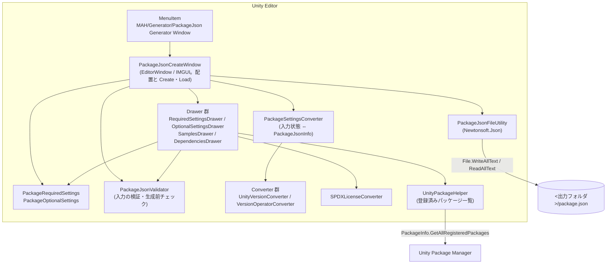
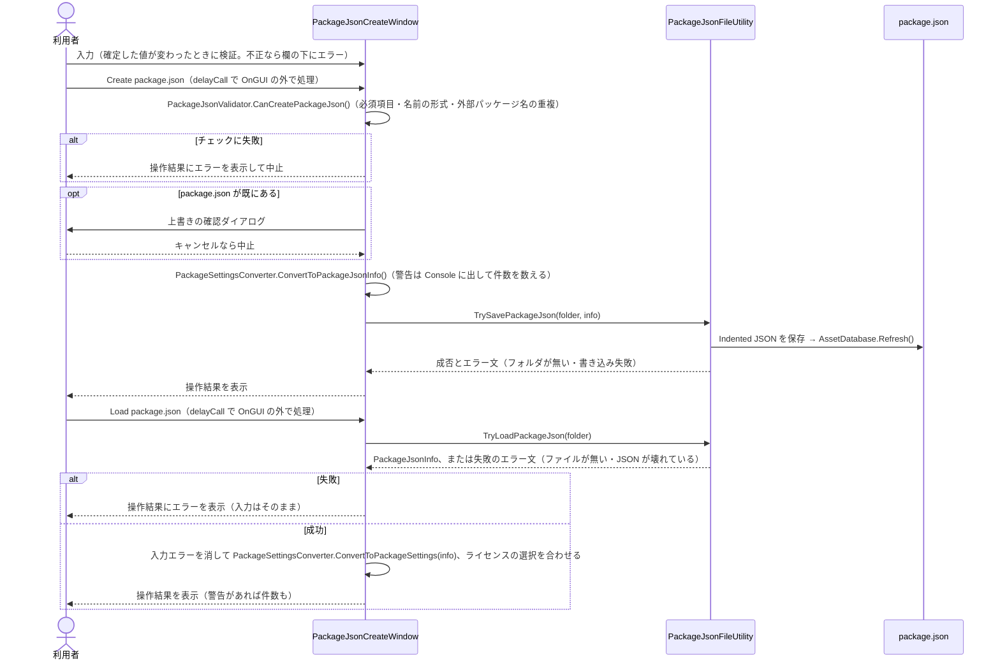

# 機能設計書：PackageJson Generator

> 最終更新日：2026-10-21 ／ 対象バージョン：パッケージ `com.mah.package-json-generator` v1.0.1／開発環境 Unity 6000.3.26f1（対応 Unity 6000.0 以上）
> 関連文書：`README.md`（利用者向け）／`CONTRIBUTING.md`（開発手順）／`CLAUDE.md`（AI向け作業ルール）
> **位置づけ**：本書は **現状の実装の振る舞い** を書き起こしたもので、「あるべき仕様」ではない。実装とずれている点や不具合の候補は §8「既知の問題」にまとめ、修正は別の作業で行う。PRD・アーキテクチャ文書・用語集はまだ無いので、クラス名はコード上の名前をそのまま使う

## 1. システム概要

### 1.1 構成図

Unity Editor の中だけで動く拡張機能（`#if UNITY_EDITOR`、asmdef `MAH.PackageJson_Generator.Editor` は Editor プラットフォーム限定）。サーバー通信やランタイムのコードは無い。



### 1.2 画面構成

画面は EditorWindow が 1 つだけ。シーンは使わない（§6 を参照）。

## 2. 機能アーキテクチャ

### 2.1 コンポーネント構成

```text
PackageJson Generator/
├── package.json                         # このツール自身のパッケージ定義
└── Editor/
    ├── MAH.PackageJson_Generator.Editor.asmdef
    ├── AssemblyInfo.cs                  # InternalsVisibleTo（開発用プロジェクトのテストから internal を呼ぶため）
    ├── PackageJsonCreateWindow.cs       # Window の生成・全体の配置・ファイル操作の欄・Create / Load・操作結果の表示
    ├── Drawer/
    │   ├── FieldErrorStore.cs           # 欄ごとの入力エラー（§4）
    │   ├── DrawerUtility.cs             # 共通のラベル・レイアウト・検証付き入力欄・バージョン入力欄
    │   ├── RequiredSettingsDrawer.cs    # 必須項目の描画（ライセンスの選択状態を持つ）
    │   ├── OptionalSettingsDrawer.cs    # 任意項目（Unity 情報・ドキュメント・キーワード）の描画。下の 2 つを持つ
    │   ├── SamplesDrawer.cs             # サンプルの描画
    │   └── DependenciesDrawer.cs        # 外部パッケージの描画
    ├── Definition/
    │   ├── PackageJsonInfo.cs           # JSONシリアライズ用モデル（[JsonProperty]）
    │   ├── AuthorInfo.cs / SampleInfo.cs# JSONモデルの子要素（UIの入力値としても使う）
    │   ├── PackageRequiredSettings.cs   # 必須項目の入力状態
    │   ├── PackageOptionalSettings.cs   # 任意項目の入力状態
    │   ├── DependenciesInfo.cs          # 依存パッケージ1件の入力状態
    │   ├── PackageSnapshot.cs           # 記憶したパッケージ 1 つ分の入力状態（§5）
    │   ├── LanguageType.cs              # 表示言語 enum（English / Japanese）
    │   ├── TextId.cs                    # 画面とメッセージの文言の ID
    │   └── LicenseType.cs               # ライセンス選択肢 enum
    └── Utility/
        ├── LocalizedText.cs             # 文言の表（英語・日本語）と今の表示言語（§7）
        ├── LicenseFileUtility.cs        # Proprietary 用の LICENSE.md のひな形の作成（§5）
        ├── PackageJsonFileUtility.cs    # 保存・読込、空値除外 Resolver
        ├── PackageJsonValidator.cs      # 入力の検証（§4）と生成前チェック（§4.3）
        ├── PackageSessionStore.cs       # 読み込んだパッケージの記憶（SessionState。§5）
        ├── PackageSettingsConverter.cs  # 入力状態 ⇔ PackageJsonInfo の変換。警告は List<string> で返す（Debug を使わない）
        ├── SPDXLicenseUtility.cs        # クラス名は SPDXLicenseConverter
        ├── UnityPackageHelper.cs        # プロジェクトに登録済みのパッケージ名・バージョンのキャッシュ
        ├── UnityVersionConverter.cs     # 対応 Unity バージョンの選択肢の表（§3.4）と unity 文字列の解析
        └── VersionOperatorConverter.cs  # Load 時にバージョン制約文字列から完全一致のバージョンを取り出す
```

> ※ 開発用プロジェクトの `Assets/@MAH/Editor/Utility/LanguageUtility.cs` はこのパッケージに含まれず、どこからも参照されていない
> ※ 開発用プロジェクトの `Assets/@MAH/Tests/Editor/` に、`PackageJsonValidator` と `PackageSettingsConverter` の EditMode テストがある（パッケージには含まれない）

### 2.2 状態

フェーズ（状態機械）は無い。入力状態は `PackageJsonCreateWindow` のフィールドに、画面の状態（Foldout の開閉など）は各 Drawer のフィールドに保持される。

| 持ち主 | フィールド | 型 | シリアライズ | 説明 |
|---|---|---|---|---|
| Window | `_scrollPos` | `Vector3` | ○ | スクロール位置 |
| Window | `_requiredSettings` | `PackageRequiredSettings` | ○ | 必須項目 |
| Window | `_optionalSettings` | `PackageOptionalSettings` | ○ | 任意項目 |
| Window | `_packageJsonPath` | `string` | ○ | 入出力フォルダ。初期値は `Assets` |
| Window | `_requiredDrawer` / `_optionalDrawer` | `RequiredSettingsDrawer` / `OptionalSettingsDrawer` | ○ | 各セクションの Drawer（下の画面の状態を持つ） |
| Window | `_isInitialized` | `bool` | ○ | 初期化済みかどうか |
| Window | `_fieldErrors` | `FieldErrorStore` | — | 欄ごとの入力エラー（§4）。キーは欄の定数、またはリストの行のオブジェクト |
| Window | `_resultMessage` / `_resultMessageType` / `_warningCount` | `string` / `MessageType` / `int` | — | 最後の Create・Load の結果と警告の件数（§5） |
| Window | `_rememberedPackages` | `List<PackageSnapshot>` | — | 記憶したパッケージの一覧（`PackageSessionStore` から読んだもの。`OnEnable` と記憶を変えたときに読み直す） |
| `RequiredSettingsDrawer` | `_licenseType` / `_licenseName` | `LicenseType` / `string` | ○ | ライセンスの選択値と表示名 |
| `OptionalSettingsDrawer` | `_isShowKeyword`、`_samplesDrawer` / `_dependenciesDrawer` | `bool`、各 Drawer | ○ | キーワードの Foldout 開閉と、サンプル・外部パッケージの Drawer |
| `SamplesDrawer` / `DependenciesDrawer` | `_isShowSamples` / `_isShowDependencies` | `bool` | ○ | 各リストの Foldout 開閉 |

「シリアライズ ○」のフィールドは `[SerializeField]` で、入力状態のクラス（`PackageRequiredSettings`、`PackageOptionalSettings`、`DependenciesInfo`、`AuthorInfo`、`SampleInfo`）と Drawer も `[Serializable]` にしてある。そのため、スクリプトの再コンパイルなどのドメインリロードでは入力と画面の状態が残る。ウィンドウを閉じると消える。
`OnEnable` は `_isInitialized` が `false` のとき（ウィンドウを開いたとき）だけ、入力状態と Drawer を作り直してライセンスを初期値にする。`UnityPackageHelper.LoadPackageInfo()` は、static のキャッシュがドメインリロードで消えるため毎回呼ぶ。

表示言語は Window ではなく `LocalizedText.AccCurrentLanguage`（static）が持ち、EditorPrefs のキー `MAH.PackageJsonGenerator.Language` に保存する（§7）。
読み込んだパッケージの記憶は `PackageSessionStore` が SessionState のキー `MAH.PackageJsonGenerator.Packages` に保存する（§5）。

### 2.3 データフロー



## 3. データモデル定義

### 3.1 入力項目と package.json キーの対応

UI ラベルは日本語表示のものを載せる。英語表示のラベルは `Utility/LocalizedText.cs` の表にある（§7）。

| 区分 | UIラベル | 保持先 | JSONキー | 出力形式・変換 |
|---|---|---|---|---|
| 必須 | パッケージ名 | `PackageRequiredSettings.Name` | `name` | 小文字化してから検証する。初期値は `com.mypackage` |
| 必須 | バージョン (Major/Minor/Patch/プレリリース) | `Version` (`Vector3Int`) / `PreRelease` (`string`) | `version` | `"{x}.{y}.{z}"`。プレリリースの表記があれば `"{x}.{y}.{z}-{表記}"`（例 `1.2.0-preview.1`。§4.6）。Load で読めない部分は補って警告を出す（§5） |
| 必須 | UPM表示名 | `DisplayName` | `displayName` | そのまま |
| 必須 | 概要 | `Description` | `description` | そのまま（TextArea） |
| 必須 | 対応 Unity バージョン (Major/Minor) | `MajorVer` / `MinorVer`（どちらも `int`） | `unity` | `"{Major}.{Minor}"`（例 `6000.0`）。初期値は `6000.0`。Major を変えると Minor はその Major の一覧の先頭になる（§3.4）。見出しの右の `Use current Editor version` ボタンで、今の Editor のバージョン（`Application.unityVersion`。例 `6000.3.26f1`）から `unity` を `6000.3`、`unityRelease` を `26f1` にする（中国版の後ろの `c1` などは含めない） |
| 必須 | ライセンス | `License` | `license` | `LicenseType` を SPDX ID に変換（§3.3） |
| 必須 | 著者名 / E-mail / URL | `AuthorInfo` | `author.name` / `.email` / `.url` | 必須なのは名前だけ |
| 任意 | リリースバージョン | `PackageOptionalSettings.UnityRelease` | `unityRelease` | そのまま。形式（`0f1`・`26f1`・`0b5` のような「数字・英字 1 字・数字」）に合わなければ、Create の前に警告を出す（§4.3） |
| 任意 | UPM除外フラグ | `HideInEditor` | `hideInEditor` | bool。false でも必ず出力される |
| 任意 | 変更ログURL | `ChangelogURL` | `changelogUrl` | URL検証あり |
| 任意 | ドキュメントURL | `DocumentationURL` | `documentationUrl` | URL検証あり |
| 任意 | ライセンスURL | `LicensesURL` | `licensesUrl` | URL検証あり |
| 任意 | キーワード一覧 | `Keywords` | `keywords` | 文字列配列 |
| 任意 | サンプル一覧（表示名/概要/パス） | `SamplesInfo` | `samples[].displayName/description/path` | パスは `Samples~` 起点に正規化（§4.4） |
| 任意 | 外部パッケージ一覧 | `Dependencies` | `dependencies` | `{ "<name>": "X.Y.Z" }` または `"X.Y.Z-表記"`（完全一致のバージョンだけ。§4.5） |
| 任意 | その他の項目（名前の一覧と `Clear` ボタンだけ。編集はできない） | `PackageOptionalSettings.ExtraJson`（JSON オブジェクトの文字列） | 上の表に無いキー（`type`、`repository`、`category`、`testables` など） | Load した値を変えずに、Create のときにそのまま書き戻す。`PackageJsonInfo.ExtraData`（`[JsonExtensionData]`）で受け取り、Unity がシリアライズできるよう文字列にして持つ（ドメインリロードと記憶でも残る）。未対応キーが無い package.json を Load すると消える。`Clear` で消せる |

### 3.2 出力時の値の除外ルール

`IgnoreEmptyAndNullResolver`（`PackageJsonFileUtility.cs`）がすべてのプロパティに対して次の値を出力から外す。

- `null`
- 空文字列または空白だけの文字列
- 要素数 0 の `ICollection`（List / Dictionary）

`bool` は除外の対象外なので、`hideInEditor` は常に出力される。
未対応キー（`ExtraData`）は、このツールが扱うキーの後ろに、読み込んだときの値のまま出力される（除外ルールの対象外）。

### 3.3 ライセンス対応表（`SPDXLicenseConverter`）

| `LicenseType` | 出力 (`license`) | 表示名 |
|---|---|---|
| `Unlicense`（初期値） | `Unlicense` | The Unlicense |
| `Proprietary` | `Proprietary` | Proprietary |
| `MIT` | `MIT` | MIT License |
| `Apache_2_0` | `Apache-2.0` | Apache License 2.0 |
| `GPL_3_0` | `GPL-3.0` | GNU General Public License v3.0 |
| `LGPL_3_0` | `LGPL-3.0` | GNU Lesser General Public License v3.0 |
| `MPL_2_0` | `MPL-2.0` | Mozilla Public License 2.0 |
| `BSD_3_Clause` | `BSD-3-Clause` | BSD 3-Clause License |
| `CC0_1_0` | `CC0-1.0` | Creative Commons Zero v1.0 |
| `EPL_2_0` | `EPL-2.0` | Eclipse Public License 2.0 |
| `Other` | 入力欄に入力した値（前後の空白を除く） | — |
| `None` | `UNLICENSED` | UNLICENSED (no permission granted) |

`Other` を選ぶと入力欄が表示される（選んだ直後は空）。入力欄が空のまま Create すると、生成前チェック（§4.3）で止まる。
Load したときに表に無い SPDX ID が書かれていた場合は `Other` として扱い、その ID を入力欄に表示する。
`None` は「誰にも使用を許可しない」を表す npm の慣習の値 `UNLICENSED` を出力する（SPDX の ID ではない。`Unlicense` は著作権を放棄するライセンスで、別物）。既存の値を変えないよう、enum の末尾に置いている。

`Proprietary` を選んでいるときだけ、ライセンスの行に `Create LICENSE.md` ボタンが出る（§5）。

### 3.4 対応 Unity バージョンの選択肢

選択肢は `UnityVersionConverter` の表（`MajorVersions`、`MinorVersionMap`）で持つ。2026-10-20 時点の最新は Unity 6.6（`6000.6`）。

| Major（画面の表示） | Minor 選択肢 |
|---|---|
| `6000`（`6000 (Unity 6)`） | 0〜6 |
| `2023` / `2022` / `2021` / `2020` | 1, 2, 3（`2023.3` は正式版が出ずに Unity 6 になったが、既存の選択肢として残している） |
| `2019` / `2018` / `2017` | 1, 2, 3, 4 |
| `5` | 0〜6 |

- 今の値が表に無い場合（一覧に無いバージョンを Load した場合）は、選択肢の末尾に `"{値}（一覧外）"` を足して選んだ状態にする。値は変えずにそのまま出力する。一覧の値を選び直すと、一覧外の選択肢は消える
- 新しい Unity が出たら、`MinorVersionMap` の該当 Major に Minor を足す。新しい Major なら `MajorVersions` と `MinorVersionMap` の両方に足す

### 3.5 出力例

全項目を入力した場合。`samples` のパスは OS に関係なく `/` 区切りで出力される。

```json
{
  "name": "com.example.my-tool",
  "version": "1.2.0",
  "description": "Example package",
  "displayName": "My Tool",
  "unity": "6000.0",
  "unityRelease": "0f1",
  "license": "MIT",
  "licensesUrl": "https://example.com/license",
  "changelogUrl": "https://example.com/changelog",
  "documentationUrl": "https://example.com/docs",
  "hideInEditor": false,
  "author": { "name": "Example", "email": "dev@example.com", "url": "https://example.com" },
  "keywords": [ "tool" ],
  "dependencies": { "com.unity.nuget.newtonsoft-json": "3.2.1" },
  "samples": [ { "displayName": "Basic", "description": "Basic sample", "path": "Samples~/Basic" } ]
}
```

## 4. 入力検証仕様

検証に通らなかった入力は破棄されて直前の値が残り、**欄の下に赤いエラー（入力した値と正しい形式の例）が表示される**。正しい値か空を入力するとエラーは消える。Load に成功したときも、すべてのエラーが消える。
検証付きの欄は `DelayedTextField` で、Enter かフォーカスアウトで確定し、値が変わったときだけ検証する（毎フレーム検証すると、`DelayedTextField` が次のフレームで今の値を返すため、エラーがすぐ消えてしまう）。エラーを表示する欄：パッケージ名、パッケージのバージョンのプレリリースの表記、著者の E-mail・URL、変更ログ・ドキュメント・ライセンスの URL、外部パッケージ名とプレリリースの表記（行ごと）、サンプルのパス（行ごと）。

### 4.1 パッケージ名（`PackageJsonValidator.IsValidPackageName`）

- 正規表現：`^[a-z0-9\-]+(\.[a-z0-9\-]+)+$`（ドットで区切った 2 要素以上）
- 入力値は先に `ToLowerInvariant()` で小文字化される
- 空にした場合は `com.mypackage` に戻る
- Load したときは小文字化だけ行い、形式に合わなくても値はそのまま残して `Debug.LogWarning` を出す。そのまま Create すると生成前チェック（§4.3）で止まる。空の名前を Load した場合は、画面に表示した時点で `com.mypackage` に戻る

### 4.2 E-mail / URL

| 項目 | 正規表現 | 空にした場合 |
|---|---|---|
| E-mail | `^[^@\s]+@[^@\s\.]+\.[^@\s\.]+(\.[^@\s\.]+)*$` | 空文字（出力されない） |
| URL（著者・各種ドキュメント） | `^https?:\/\/[\w\-]+(\.[\w\-]+)+([\/\w\-.~:?#[\]@!$&'()*+,;=]*)?$` | 空文字（出力されない） |

各 URL 欄の `Open URL` ボタンは、設定済みの値を `Application.OpenURL` で開く。

### 4.3 生成前チェック（`PackageJsonValidator.CanCreatePackageJson`）

次のどれかが空白なら `Debug.LogError` を出して生成を中止する：パッケージ名、概要、UPM表示名、ライセンス、著者名。バージョンと Unity バージョンはチェックしない。

パッケージ名が §4.1 の形式に合わない場合も、`Debug.LogError` を出して生成を中止する（Load した不正な名前がそのまま出力されるのを防ぐため）。

続けて、外部パッケージ名の重複を調べる。名前が正しい形式の行のうち、同じ名前が 2 件以上あれば、重複した名前を `Debug.LogError` に出して生成を中止する（名前が正しくない行は出力されないので対象外）。

チェックを通ったら、`PackageJsonValidator.GetCreateWarnings` で次を確かめ、当てはまれば `Debug.LogWarning` を出す。**作成は止めない**（サンプルのフォルダを後から作る手順もあるため）。警告の件数は操作結果に表示される。
- サンプルのパスのフォルダが、フォルダーパスのフォルダの中に無い（`Samples~/Basic` が無くても、開発中の `Samples/Basic` があれば警告しない）
- `unityRelease` が空でなく、`^\d+[a-z]\d+$`（例 `0f1`、`26f1`、`0b5`）に合わない（前後の空白は無視する）

### 4.4 サンプルのパス（`PackageJsonValidator.IsValidSampleFolderPath`）

1. `Browse` でフォルダを選ぶか、テキストを直接入力する（`DelayedTextField` なので、Enter かフォーカスアウトで確定したときに処理する）
2. `\` を `/` に置き換え、`/` で区切ってフォルダ名の並びにする
3. フォルダ名が `Samples` または `Samples~`（大文字小文字は区別しない）に一致する要素のうち、最後のものを探す。部分一致（`MySamples` など）は対象にしない
4. 見つけた要素より後ろのフォルダ名を `/` でつなぎ、`Samples~/<残り>` にする（例 `.../Samples/Basic` → `Samples~/Basic`）
5. 一致する要素が無い場合と、後ろが空の場合は、値を変えない

初期値：サンプルを追加したとき（1 件目・2 件目以降とも）と `Reset` ボタンを押したときは、どれも `Samples~`。
Load したときは、パスの `\` を `/` に置き換える（以前のバージョンが Windows で `Samples~\\Basic` の形で出力していたため）。

### 4.5 依存パッケージ（`dependencies`）

- パッケージ名は `DelayedTextField` で入力し、確定（Enter かフォーカスアウト）したときに小文字化して §4.1 と同じ規則で検証する。空にすると `com.` に戻る
- 右側の Popup で、プロジェクトに登録済みのパッケージ（`UnityPackageHelper`）を選べる。選ぶと名前とバージョンが入力される。先頭の `– Select Package –` を選ぶと、その行がリセットされる。名前を手で変えたときと Load したときは、Popup の選択位置を名前に合わせる（一覧に無ければ先頭）
- バージョンは Major / Minor / Patch とプレリリースの表記（任意。§4.6）を入力し、`"X.Y.Z"` または `"X.Y.Z-表記"` の完全一致の形で出力する（UPM は比較演算子や範囲を受け付けないため）。Popup でプレビュー版の登録済みパッケージ（例 `1.0.0-pre.3`）を選ぶと、表記まで入る
- 名前が正しい形式でない行（初期値 `com.` のままの行など）は出力せず、`Debug.LogWarning` を出す。有効な行が 0 件なら `dependencies` キーは出力しない
- Load のときは `VersionOperatorConverter.TryExtractVersion` で値を読む：

| package.json の値（前後の空白は無視） | 読み込み結果 | 警告 |
|---|---|---|
| `1.2.3` / `1.2.3-preview.1` | そのまま（表記も読む） | なし |
| `>=1.2.3` / `> 1.2.3` / `<1.2.3` / `<=1.2.3`（表記付きも同じ） | `1.2.3` | 変換した旨 |
| `1.0.0 - 2.0.0`（`-` の前後に空白がある） | 下限の `1.0.0` | 変換した旨 |
| 表記が SemVer の規則に合わない（`1.2.3-01`） | `1.2.3`（表記は読み捨てる） | 変換した旨 |
| 上のどれにも当てはまらない値（`file:` など） | 読み込まない | 除外した旨 |

空白の無い `1.0.0-2.0.0` は、SemVer の規則どおり「`1.0.0` のプレリリース `2.0.0`」として読む（以前は範囲として下限の `1.0.0` にしていた）。

### 4.6 プレリリースの表記（`PackageJsonValidator.IsValidPreRelease`）

- パッケージのバージョンと外部パッケージのバージョンの、Patch の後ろの入力欄に入れる（`DelayedTextField`。確定したときに検証）
- SemVer 2.0.0 の規則：`.` で区切った各部分が英数字とハイフン。数字だけの部分は先頭が 0 でない（`preview.1`、`exp.2`、`rc-1.0` は正しい。`01`、`pre..1`、`pre_1` は誤り）
- 空ならプレリリースではない（`"X.Y.Z"` を出力する）
- ビルドメタデータ（`+build.5`）は入力できない。Load したときは読み捨てて警告を出す

## 5. ファイル入出力仕様

| 操作 | 振る舞い |
|---|---|
| 入出力フォルダ | テキスト入力、または `Browse`（`Application.dataPath` 配下を選んだ場合は `Assets/...` の相対パスに変換）。`Reset` で `Assets` に戻る |
| Create package.json | 生成前チェック（§4.3）のあと、`<フォルダ>/package.json` が既にあれば上書きの確認ダイアログを出す。保存したら `AssetDatabase.Refresh()` を呼ぶ。フォルダが空白・存在しない場合や、書き込みに失敗した場合は、例外を出さずにエラーを表示して中止する |
| Load package.json | `<フォルダ>/package.json` を読み込み、入力欄に反映する。ファイルが無い場合や、JSON として読めない場合は、エラーを表示し、**入力中の内容はそのまま残す** |
| 操作結果の表示 | ボタンの上に、最後の Create・Load の結果を `HelpBox` で表示する。成功は Info（作成・読み込みしたパス）、警告があった成功は Warning（件数と「詳しくは Console を参照」）、失敗は Error（理由）。Console への出力も残す |
| LICENSE.md の作成 | ライセンスが `Proprietary` のときの `Create LICENSE.md` ボタンで、`<フォルダ>/LICENSE.md` に英語の独自ライセンスのひな形（`Copyright (c) {今年} {著者名}. All rights reserved.` と、無断の複製・改変・配布・使用を禁じる文）を作る。著者名が空なら作らずにエラーを表示する。既にファイルがあれば上書きの確認ダイアログを出す。フォルダが空白・存在しない場合や書き込みに失敗した場合は、例外を出さずにエラーを表示する。作ったら `AssetDatabase.Refresh()` を呼ぶ。ひな形であり、法的な正しさは保証しない |
| JSON プレビュー | ファイル操作の欄の「JSON プレビュー」の Foldout を開くと、Create したときに出力される内容（`PackageJsonFileUtility.SerializePackageJson` の結果）を読み取り専用の欄に表示する（高さは最大 200。超えたらスクロール）。開いている間は `Layout` のイベントごとに作り直すので、入力を変えると表示も変わる。警告は出さない（Create のときに出す） |
| 読み込んだパッケージの記憶 | Load または Create に成功すると、そのパッケージの入力内容を、フォルダーパスで区別して `PackageSessionStore`（SessionState）に記憶する（同じフォルダは上書き）。記憶が 1 件以上あると、ウィンドウ上部に「記憶したパッケージ」の Popup（`パッケージ名 (フォルダーパス)`）と `Remove from list` ボタンが出る。今のフォルダが記憶されていなければ、Popup の先頭に「（記憶していないパッケージ）」を出す。別のパッケージを選ぶと、今のフォルダが記憶済みなら今の入力（保存前の編集を含む）を記憶し直してから、選んだパッケージの入力内容とフォルダーパスに切り替える（入力エラーを消し、ライセンスの選択を合わせる）。ウィンドウを閉じるとき（`OnDisable`）も、今のフォルダが記憶済みなら記憶し直す。記憶は Unity Editor を閉じると消える |
| 処理のタイミング | Create・Load・LICENSE.md の作成・記憶したパッケージへの切り替えは `EditorApplication.delayCall` で `OnGUI` の外で行う（レイアウトの途中でモーダルダイアログを出すと、レイアウトのエラーが出ることがあるため） |
| 文字コード | `File.WriteAllText` の既定（UTF-8、BOM なし） |

Load で値が無い・形式が違う場合も例外は出さず、次のように補って `Debug.LogWarning` を出す。他の項目はそのまま読み込む。

| 項目 | package.json の値 | 読み込み結果 |
|---|---|---|
| `unity` | 無い / 空 / 数字でない（`abc`、`6000.x`） | `6000.0` |
| `unity` | Minor が無い（`6000`） | その Major の一覧の先頭（`6000.0`） |
| `unity` | 一覧に無い（`6000.7`、`2024.1`） | そのまま（§3.4 の「一覧外」） |
| `version` | 無い / 空 / 数字でない（`a.b.c`） | `0.0.0` |
| `version` | 要素が足りない（`1.2`） | `1.2.0` |
| `version` | 要素が多い（`1.2.3.4`） | `1.2.3` |
| `version` | プレリリースの表記が規則に合わない（`1.2.3-01`）・ビルドメタデータ付き（`1.2.3+build.5`） | `1.2.3`（規則に合う表記は残す） |

プレリリースの表記が規則に合う値（`1.2.3-preview.1`）は、表記まで読み込み、警告は出さない。

## 6. 画面設計

### 6.1 画面一覧

| 画面ID | 画面名 | 実装 | 起動方法 |
|---|---|---|---|
| WIN-001 | PackageJson Generator | `PackageJsonCreateWindow`（IMGUI EditorWindow） | メニュー `MAH/Generator/PackageJson Generator Window` |

### 6.2 WIN-001 レイアウト

```text
                              言語 [English / 日本語 ▼]（右上。スクロールしない）
記憶したパッケージ [パッケージ名 (フォルダーパス) ▼] [Remove from list]（記憶が 1 件以上あるときだけ）
┌ ScrollView ───────────────────────────────┐
│ [必須設定項目]                              │
│   パッケージ情報設定（名前/バージョン/UPM表示名/概要）│
│   対応 Unity バージョン設定（Major/Minor）[Use current Editor version] │
│   ライセンス情報設定（Proprietary のときだけ [Create LICENSE.md]）│
│   著者情報設定（著者名/E-mail/URL + Open URL）  │
│ [任意設定項目]                              │
│   Unity 情報設定（リリースバージョン/UPM除外フラグ） │
│   ドキュメント情報設定（3種URL + Open URL）      │
│   キーワード / サンプル / 外部パッケージ（Foldoutリスト）│
│   その他の項目（未対応キーがあるときだけ。名前の一覧 + [Clear]）│
└──────────────────────────────────────────┘
[package.json ファイル操作]（スクロールしない固定領域）
  フォルダーパス [_____] [Browse] [Reset]
  ▶ JSON プレビュー（Foldout。開くと出力される内容を表示）
  （最後の Create・Load の結果。HelpBox）
  [Create package.json] [Load package.json]
```

検証付きの欄（§4）で入力エラーがあると、その欄（リストの場合はその行）のすぐ下に赤い `HelpBox` が表示される。
リストの操作は次の通り。キーワードは各行に `Remove` がある。サンプルと外部パッケージは、リスト末尾の `Remove`（最後の要素を消す）と `Add` で操作する。

## 7. 非機能設計

| 項目 | 内容 |
|---|---|
| 依存 | `com.unity.nuget.newtonsoft-json` 3.2.1（このツール自身の package.json で宣言） |
| 対応 Unity | 6000.0 以上（package.json の `unity`） |
| 永続化 | ドメインリロード（スクリプトの再コンパイルなど）では入力内容が残る（§2.2）。ウィンドウを閉じると今の入力は消えるが、Load / Create したパッケージは「記憶したパッケージ」から選び直せる（Unity Editor を閉じるまで。§5）。表示言語は EditorPrefs に保存する |
| エラー通知 | 入力エラーは欄の下（§4）、Create・Load の結果はファイル操作の欄（§5）に表示する。あわせて Console にも `Debug.LogWarning` / `Debug.LogError` で出す。メッセージは表示言語に合わせる |
| ローカライズ | 英語・日本語。画面のラベル・入力エラー・操作結果・確認ダイアログ・Console のメッセージを、`TextId` と `LocalizedText` の表で切り替える。ボタン名（`Browse`・`Reset`・`Open URL`・`Add`・`Remove`・`Create package.json`・`Load package.json`）とライセンスの選択肢は、どちらの言語でも英語。言語はウィンドウ右上で選び、EditorPrefs（`MAH.PackageJsonGenerator.Language`）に保存する。一度も選んでいないときは、`Application.systemLanguage` が日本語なら日本語、それ以外は英語。切り替えたときは、表示中の入力エラーと操作結果を消す（言語が混ざらないようにするため） |

## 8. 既知の問題（次フェーズへの入力）

コードを読んで見つけた不具合の候補。「要検証」は Editor で動かしての確認がまだのもの。

| ID | 区分 | 内容 | 該当箇所 |
|---|---|---|---|
| K-1 | 仕様不整合 | **修正済み（2026-10-20）**：完全一致のバージョンだけを出力するようにした。UPM の `dependencies` は厳密なバージョン指定しか受け付けないが、比較演算子と範囲（`>=`、`1.0.0 - 2.0.0` など）を出力できてしまう | `VersionOperatorConverter` |
| K-2 | 不具合 | **修正済み（2026-10-20）**：K-1 の修正で比較演算子を廃止したため解消。`GreaterThan` だけ出力が `"> "`（記号の後に空白）になり、他の演算子と形式が揃っていない | `VersionOperatorToOperatorString` |
| K-3 | 不具合 | **修正済み（2026-10-20）**：入力欄の値を保存するようにした。ライセンスに `Other` を選ぶと、入力欄の値が保存されず `License` が空のままになる。そのため必ず生成エラーになる | `DrawLicenseInfoSettings` |
| K-4 | 不具合 | **修正済み（2026-10-20）**：Minor が無い場合は一覧の先頭を使うようにした（§5）。Load で `unity` が `"6000"` のように Minor を持たない場合、`Length < 1` の判定ではすり抜けて `IndexOutOfRangeException` が起きる | `ConvertToMinorVersion` |
| K-5 | 不具合 | **修正済み（2026-10-20）**：読めない値は `6000.0` に、一覧に無い Major はそのまま扱うようにした（§3.4、§5）。Load で `unity` が無い場合や未対応の Major の場合に `NotImplementedException` が発生し、読み込みが止まる | `ConvertToMajorVersion` / `StringToMajorVersion` |
| K-6 | 不具合 | **修正済み（2026-10-20）**：先頭の数字だけを読み、足りない部分は 0 で補うようにした（§5）。外部パッケージの Popup でプレビュー版を選んだときの同じ例外も直した。Load で `version` が無い場合は NRE が起きる。4 要素以上（例 `1.0.0.1`）の場合は `Vector3Int` のインデックス範囲外になる | `ConvertToVersionVector` |
| K-7 | 不具合 | **修正済み（2026-10-20）**：一覧に無い値は「一覧外」として表示・出力するようにした（§3.4）。Minor が enum に無い値（例 `6000.3`）を Load すると、EnumPopup に正しく表示されない（要検証） | `DrawUnityVersionSettings` |
| K-8 | 不具合 | **修正済み（2026-10-20）**：生成前に重複を検出してエラーを出すようにした。依存パッケージに同じ名前が 2 件あると `Dictionary.Add` が例外を投げ、生成が失敗する | `ConvertToDependencies` |
| K-9 | 不具合 | **修正済み（2026-10-20）**：フォルダ名単位で判定し、`/` 区切りで出力するようにした（§4.4）。サンプルのパスが `Path.Combine` で作られるため、Windows では `\` 区切りで出力される。また、OpenFolderPanel が返す `/` 区切りのパスは TrimStart で取り除かれず、結果がルートパス扱いになる恐れがある。`Samples~` を選んだ場合も先に `Samples` に一致するため、`~` が残る恐れがある（要検証） | `IsValidSampleFolderpath` |
| K-10 | 不具合 | **修正済み（2026-10-20）**：初期値を `Samples~` に統一した。あわせて、Reset ボタンを押しても入力欄の古い値ですぐ上書きされ、Reset が効かなかった問題も直した。サンプルの初期パスが一定しない（1 件目は `Samples~`、2 件目以降は `null`、Reset 時は `Samples`） | `DrawSamplesInfoSettings` |
| K-11 | 不具合 | **修正済み（2026-10-20）**：名前が正しくない行は警告を出して出力しないようにした。依存パッケージの初期値 `com.` は検証に通らない値のまま出力される（`"com.": "0.0.0"`） | `DependenciesInfo` |
| K-12 | UX | **修正済み（2026-10-20）**：欄の下に入力エラーを、ファイル操作の欄に Create・Load の結果を表示するようにした。入力が検証に通らなかったときに何も通知されず、直前の値に戻るだけ | `PackageJsonCreateWindow` 全般 |
| K-13 | UX | **修正済み（2026-10-20）**：失敗時は入力を残すようにした。Load でファイルが見つからないと、入力中の内容がすべてリセットされる | `ConvertToPackageSettings` |
| K-14 | UX | **修正済み（2026-10-20）**：上書きの前に確認ダイアログを出すようにした。Create のときに既存ファイルを確認なしで上書きする | `SavePackageJson` |
| K-15 | UX | **修正済み（2026-10-20）**：入力状態を `[SerializeField]` にし、初期化は最初の 1 回だけにした（§2.2）。`OnEnable` で毎回初期化するので、スクリプトの再コンパイルなどのドメインリロードで入力内容が消える | `OnEnable` |
| K-16 | 不具合 | **修正済み（2026-10-20）**。`PackageOptionalSettings.Reset()` が `HideInEditor` をリセットしない | `PackageOptionalSettings` |
| K-17 | 不具合 | **修正済み（2026-10-20）**：enum をやめて `UnityVersionConverter` の表にし、`6000.6` と `5.0` を足した（§3.4）。対応 Unity の選択肢が古い（Unity 6 は 6000.0〜6000.2 まで。Unity 5 に 5.0 が無い） | `Definition/UnityVersion/` |
| K-18 | 不具合 | **修正済み（2026-10-20）**：Load 時に小文字化して警告を出し、生成前チェックで形式も確かめるようにした。ライセンスは K-3 の修正で入力欄に表示・編集できる（§3.3）。Load したパッケージ名は検証されない。Load したライセンスが `Other` の場合、SPDX ID が UI に表示されない | `ConvertToPackageSettings` |
| K-19 | 表記 | **修正済み（2026-10-21）**：下の名前と、同じ種類の誤り（`*_ERORR_MESSAGE` → `*_ERROR_MESSAGE`、`VERSITON` → `VERSION`、`depensencies_layout`、`apth_button_layout`、`IsValidSampleFolderpath` → `IsValidSampleFolderPath`）を直した。シリアライズされる `PackageName` と `_packageJsonPath` には `FormerlySerializedAs` で古い名前を残している。UI ラベルの誤字：`UMP除外フラグ`（正しくは UPM）。識別子の誤字：`_pacckageJsonPath`、`PacckageName`、`PACKGAGE_*` など（`VersionOperater.cs` は 2026-10-20 に K-1 の修正でファイルごと削除） | 各所 |
| K-20 | 設計 | **修正済み（2026-10-21）**：検証（`PackageJsonValidator`）・変換（`PackageSettingsConverter`）・描画（`Drawer/`）に分け、検証と変換に EditMode テストを付けた（§2.1）。`PackageJsonCreateWindow` が UI・検証・変換をすべて抱えている（約1,080行） | — |
| K-21 | 設計 | 開発用プロジェクトと配布フォルダに同じコードが二重にあり、手動で同期している（同期漏れのため、package.json の version が 1.0.0 と 1.0.1 で食い違っていたことがある。2026-10-20 に 1.0.1 へ揃えた） | `CONTRIBUTING.md` を参照 |
| K-22 | 設計 | **修正済み（2026-10-21）**：負の値は 0 にするようにした（`DrawerUtility.DrawVersionFields`）。バージョン番号やバージョン構成要素に負の値を入力できる | `IntField` 各所 |
| K-23 | 運用 | Git タグの命名が揃っていない（`v1.0.0` と `1.0.1`）。また、タグ `1.0.1` は package.json を 1.0.1 に上げる前のコミット（95ee343）を指している | Git タグ |
| K-24 | 不具合 | **修正済み（2026-10-20）**：確定時にだけ検証する `DelayedTextField` に変えた。依存パッケージ名の欄が 1 文字ごとに検証されるため、`com.example.` のように `.` で終わる途中の値が不正として捨てられ、3 要素以上の名前を手で入力できなかった | `DrawDependenciesSettings` |
| K-25 | 不具合 | **修正済み（2026-10-20）**：確定時にだけ検証する `DelayedTextField` に変えた。サンプルのパス欄が 1 文字ごとに検証されるため、入力途中の値が不正として捨てられ、パスを手で入力できなかった | `DrawSamplesInfoSettings` |
| K-26 | 不具合 | **修正済み（2026-10-20）**：例外を捕まえてエラーを表示するようにした。JSON として正しくない package.json を Load すると、`JsonException` で止まった | `LoadPackageJson` |
| K-27 | 不具合 | **修正済み（2026-10-20）**：保存前にフォルダの有無を確かめ、書き込みの例外も捕まえるようにした。存在しないフォルダを指定して Create すると、`DirectoryNotFoundException` で止まった | `SavePackageJson` |
