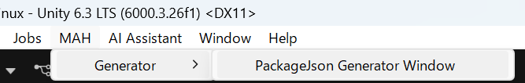
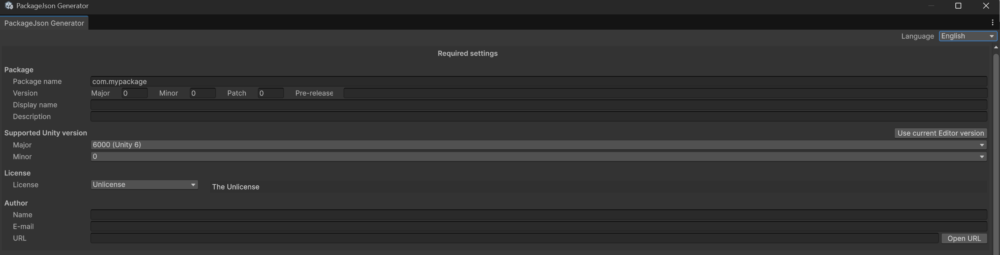
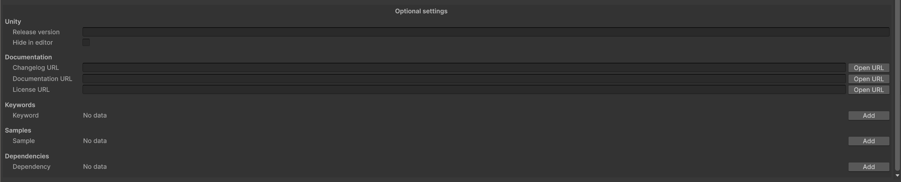
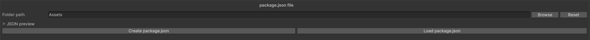
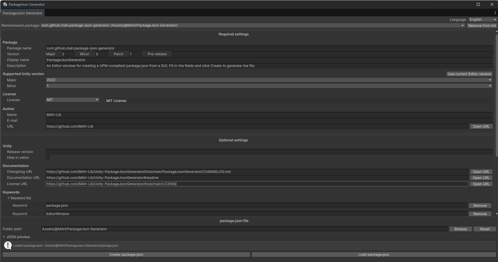

# Unity-PackageJsonGenerator

[日本語 / Japanese](README.ja.md)

An Editor extension that lets you create the `package.json` file required to publish a UPM (Unity Package Manager) package, using a simple GUI.

## Requirements

| Item | Version |
|---|---|
| Unity | 2022.1 or later |
| Dependency | `com.unity.nuget.newtonsoft-json` 3.2.1 (installed automatically) |

## Installation

### Via Package Manager (Git URL)

1. Copy the Git URL below.

   ```
   https://github.com/MAH-Lib/Unity-PackageJsonGenerator.git?path=PackageJsonGenerator
   ```

2. Open **Window > Package Manager**, click the **+** button, and select **Install package from git URL...**
3. Paste the URL and click **Install**.

### Via manifest.json

Add the following line to the `dependencies` section of `Packages/manifest.json`:

```json
"com.github.mah.package-json-generator": "https://github.com/MAH-Lib/Unity-PackageJsonGenerator.git?path=PackageJsonGenerator"
```

To pin a specific version, append a release tag to the URL (for example `...?path=PackageJsonGenerator#2.0.0`). See [Tags](../../tags) for the available tags.

## Usage

> The window is available in English and Japanese. Choose the language from **Language** at the top right of the window. Your choice is saved for next time. When you open the window for the first time, it uses Japanese if your computer's language is Japanese, and English otherwise. (The screenshots below show the English window.)

1. From the menu bar, select **MAH > Generator > PackageJson Generator Window**.

   

2. Fill in the fields in the Editor window.

   - **Required settings**: these must be filled in. In the author settings, **E-mail** and **URL** are optional.

     

   - **Optional settings**: fill in only what you need.

     

3. Click **Browse** and select the folder where `package.json` will be created. **Reset** sets the folder back to `Assets`.

   

4. Click **Create package.json** to write the file.

   

### Editing an existing package.json

Set the folder that contains the existing `package.json`, then click **Load package.json**. The fields are filled with the file's contents. You can edit them and click **Create package.json** to save again.

Keys that this tool does not handle (for example `type`, `repository` or `testables`) are kept and written back unchanged. They are listed under **Other keys** in the optional settings, and **Clear** removes them.

Open **JSON preview** above the buttons to see the content that **Create package.json** will write.

### Working on several packages

Each package you load or create is remembered until you close the Unity Editor. Choose a package from **Remembered packages** at the top of the window to switch to it. Your unsaved edits to the current package are kept when you switch, and also when you close the window. **Remove from list** removes the current package from the list.

## Fields

| Section | Field (label in the English window) | `package.json` key | Notes |
|---|---|---|---|
| Required | Package name | `name` | Lowercase, dot-separated (e.g. `com.company.my-tool`) |
| Required | Version | `version` | Major / Minor / Patch, and an optional **Pre-release** label (e.g. `preview.1` gives `1.2.0-preview.1`) |
| Required | Display name | `displayName` | Name shown in Package Manager |
| Required | Description | `description` | |
| Required | Supported Unity version | `unity` | Minimum supported Unity version (e.g. `6000.0`). Choose from Unity 5.0 to Unity 6.6 (`6000.6`). **Use current Editor version** sets this and the release version from the Editor you are using |
| Required | License | `license` | Choose from common SPDX licenses. **None** writes `UNLICENSED` (no permission granted). **Other** lets you enter any SPDX ID. When **Proprietary** is selected, **Create LICENSE.md** creates a `LICENSE.md` template with the author name and the current year in the folder (a template only, not legal advice) |
| Required | Author | `author` | Name is required. E-mail and URL are optional |
| Optional | Release version | `unityRelease` | e.g. `0f1`. A warning is shown when you create the file if the format looks wrong |
| Optional | Hide in editor | `hideInEditor` | |
| Optional | Changelog / Documentation / License URL | `changelogUrl` / `documentationUrl` / `licensesUrl` | Must start with `http://` or `https://` |
| Optional | Keywords | `keywords` | |
| Optional | Samples | `samples` | Path is converted to start with `Samples~`. A warning is shown when you create the file if the folder does not exist in the package folder |
| Optional | Dependencies | `dependencies` | Exact versions only (`X.Y.Z`, or `X.Y.Z-pre.1` with a pre-release label), as required by Unity Package Manager. You can pick packages installed in your project |

Empty optional fields are not written to the file.

## Known limitations

- Packages you have not loaded or created yet (not in **Remembered packages**) are cleared when the window is closed. Remembered packages are cleared when the Unity Editor is closed.

These will be addressed in future updates.

## Support

- **Bug reports and feature requests**: [Issues](../../issues)
- **Questions and discussions**: [Discussions](../../discussions)

Thank you for your contributions!

## License

This project is licensed under the MIT License. See [LICENSE](LICENSE) for details.
